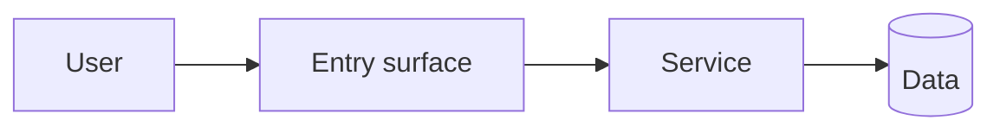

# Overall plan

_Phase 1 of the planning subagent — see AGENTS.md **Planning Phase**. This document is the source of truth for the whole request. Phase 2 sub-plans (per-feature) live at `.harness/plans/feat-NNN.md` and link back here._

_This plan always covers the full request; implementation order is decided after Phase 2 breakdown approval (see AGENTS.md **Approval gates** → Where to start), not here._

_Planning elicitation is transient. Incorporate confirmed decisions into the relevant plan sections; do not copy raw questions, answers, option labels, or form metadata into this artifact._

## Goal

Restate what the human asked for in your own words. What outcome are we shipping?

## System-level flow

Replace the placeholder with a mermaid diagram of the end-to-end user/data flow across services. **One** diagram for the whole request; per-feature diagrams live in the Phase 2 plans.

## Feature split

- **feat-001 — <name>** _(type: feat)_ — one paragraph describing the deliverable, who it serves, and how it's independently verifiable.
- **feat-002 — <name>** _(type: feat)_ — …
- **feat-003 — <name>** _(type: fix|refactor|chore|…)_ — …

## Visual direction

**Components:** <`uiLibrary` from feature_list.json — e.g. "shadcn/ui (Next.js)", "MUI", or "hand-built". If it was `none`, the library the human chose for this request>

**UI work only.** Where the screens' look comes from: an existing design system, a design file, or — for a new product — the agreed brand feel, density, and tone plus the reference products the screens will draw on (see `.harness/templates/ui-build.md`). For a new product with no design system, propose a **foundation** feature (tokens, app shell, core components) before any screen.

## Cross-cutting concerns

- Migrations, auth changes, dependency additions, feature flags — anything that touches multiple features or services.

## Assumptions

- **[confirmed]** — an assumption the human explicitly confirmed in this thread.
- **[unconfirmed]** — an inference the subagent made without asking. Unconfirmed assumptions require breakdown approval before rows are written.

## Risks / rollout notes

- Deployment sequencing hints (e.g. feature ordering, migration prerequisites, dependency chains).
- Known risks, mitigation ideas, follow-up work.
