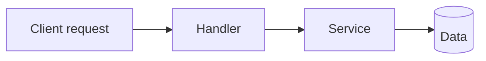

# {{FEATURE_NAME}} ({{FEAT_ID}})

_Phase 2 sub-plan produced by the planning subagent after Phase 1's overall plan was approved. This file is the implementation contract for the feature: rows in `feature_list.json` point here via `planFile`, and a fresh session reads it before working any of them. See the overall plan for context._

## Overview

One-paragraph summary: what the feature delivers, why it matters, who uses it.

## Acceptance criteria

**Required.** Feature-level "done when" checklist — **observable outcomes** a human could check by using the feature. Complements each task's Objectives under **Task specs** (task-level there, feature-level here); never a copy of them.

- Submitting the form with an empty phone field is rejected with an inline error; nothing is saved.
- A saved contact appears in the list without a page reload.
- Opening the list with no contacts shows the empty state, not a spinner.

<!-- Not acceptance criteria — these restate the implementation, not the outcome:
     ✗ "Add a `validatePhone` helper in `utils/validation.ts`"
     ✗ "Wire the POST handler to the service layer"
     Those belong in Files to touch / Task summary. -->

## Flow diagram

Feature-scoped flow — routes/handlers/functions the request/data flows through inside this feature.

## Files to touch

| File | What changes | Connections |
|---|---|---|
| `src/api/foo.ts` | Adds endpoint `POST /api/foo` | Called from `src/pages/foo.tsx`; writes `foo` table |
| `src/events/foo-created.ts` | Publishes new event `FooCreated` | Consumed by … |

For each file, describe the change in code terms, not English. When a code-graph tool is available, populate `Connections` with real edges (calls, imports, DB tables, topics) — otherwise infer from imports.

## Detailed component/module map

For each file above:

- **Exports/entry points changed** — function signatures added or altered, new classes, new endpoints.
- **Function signatures added** — parameters, return types.
- **DB tables or message topics touched** — schema changes, new topics/consumers.
- **Config keys read** — new config or env-var keys.

## Data flow

Inputs → transformations → outputs at the function/route level. Where does data enter? What functions transform it? Where does it leave (response body, event bus, storage)?

## Behaviour checks

The feature-level scenarios the Reviewer will drive in the running app — happy path, error cases, edge cases. There are no tests in this harness; if a scenario can't be driven locally (needs a third-party sandbox, destructive data), say so here so the gap is known before implementation.

- <scenario> → <expected observable result>
- <error scenario> → <expected observable result>

## Interface contracts

- **Request/response shapes** — new endpoint payloads (JSON schema or code excerpt).
- **Event schemas** — new/changed events.
- **Storage schemas** — new tables, columns, indexes.

## Task specs

One subsection per task, in implementation order. The heading is the task's actionable sentence — the **same** sentence used as the row `name` in `feature_list.json`. Each spec must clear the content bar in AGENTS.md (**Task spec content bar**): real, task-specific content; every objective observable in the running app; no pointers back to this plan or the overview; no boilerplate shared across tasks.

### task-NNN — Reject blank todo titles with an inline error

- **Target file:** `src/components/TodoForm.tsx`
- **Summary:** Submitting the add-todo form with an empty or whitespace-only title currently saves a blank row. Trim the input before validation, block the submit, and show an inline error under the field so users understand why nothing was added. The list and storage stay unchanged on rejection.
- **Objectives:**
  - Whitespace-only input shows "Title is required" under the field and does not call `addTodo`.
  - A valid title is trimmed before it is saved.
  - The error clears as soon as the user types a non-blank character.
- **Regression risks:**
  - `addTodo` is also called by the import flow — validation lives in the form, not the store, so import behaviour is unchanged.
- **How to observe:**
  - Submit "   " → "Title is required" appears under the field; the list count is unchanged.
  - Submit " buy milk " → a todo titled "buy milk" appears.
  - With the error showing, type "a" → the error disappears.
- **Technical notes:** reuse the existing `FieldError` component for styling consistency.

## Sequencing within the feature

Order tasks with explicit "why this depends on that" notes — not just `dependencies: []` in `feature_list.json`.

1. **task-NNN** — must run first because …
2. **task-NNN** — depends on task-NNN's schema being in place …

## Dependencies

- External dependencies to add — each vetted for maintenance and run through the package manager's audit before install.
- Cross-feature dependencies (rare — usually captured in the overall plan).

## Risks

- Failure modes, migration risks, rollback strategy, backwards-compatibility notes.
